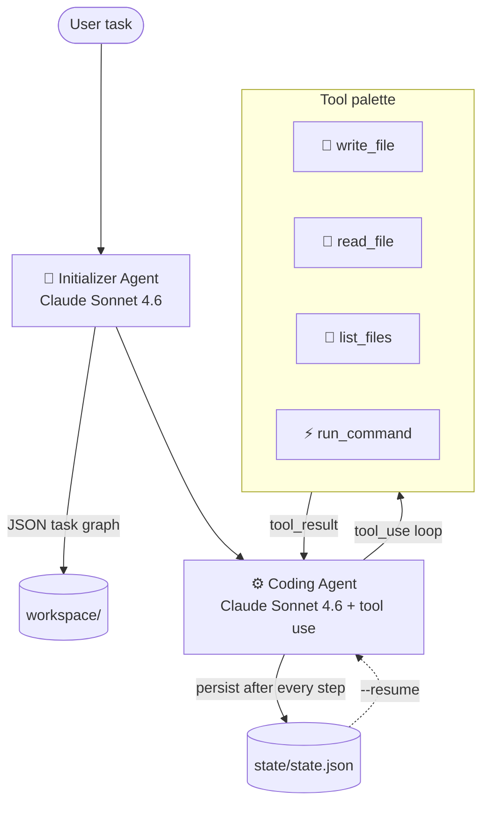

<div align="center">
  
</div>

<div align="center">


</div>

A **two-agent autonomous coding system** powered by **Claude Sonnet 4.6**. Hand it a natural-language task — it plans, codes, and runs the solution end-to-end with real tool use and crash-resumable state.

## 🏗️ Architecture



State is persisted to `state/state.json` **after every step**, so if the run is interrupted, `--resume` picks up exactly where it left off.

## 🚀 Quick start

```bash
git clone https://github.com/Dhanush-Aries/autonomous-coding-agent
cd autonomous-coding-agent

pip install -r requirements.txt

cp .env.example .env                    # add ANTHROPIC_API_KEY
python main.py "build a fibonacci calculator"
```

## ⌨️ CLI

```bash
python main.py "build a REST API with FastAPI"   # new task
python main.py --resume                           # continue interrupted session
python main.py --demo                             # built-in demo task
python main.py --status                           # show current state
python main.py --clear                            # clear saved state
```

## ✨ Features

- 🛠️ **Real Claude tool use** — not simulated; full Anthropic SDK tool_use loop
- 💸 **Prompt caching** on system prompts for cost-efficient long sessions
- 💾 **Crash-resumable** — state persists per step; `--resume` continues anywhere
- 🎨 **Rich terminal UI** — colour-coded panels for every tool call
- 🔍 **Glass-box agentic loop** — full visibility into the plan, every action, every result

## 📂 Project structure

```
autonomous-coding-agent/
├── main.py                 # CLI entry point
├── agents/
│   ├── initializer.py      # Planning agent (Claude → JSON plan)
│   └── coder.py            # Coding agent (agentic loop + tool use)
├── tools/
│   ├── file_tools.py       # write_file · read_file · list_files
│   └── shell_tools.py      # run_command
├── state/
│   └── manager.py          # AgentState dataclass + JSON persistence
├── workspaces/             # Generated projects land here (gitignored)
├── requirements.txt
└── .env.example
```

## ⚙️ Requirements

- Python 3.10+
- `ANTHROPIC_API_KEY` in `.env`
- `anthropic>=0.43.0` · `rich>=13.7.0` · `python-dotenv>=1.0.0`

## 📜 License

MIT — see [LICENSE](./LICENSE)

---

<sub>Part of the <a href="https://github.com/Dhanush-Aries">Dhanush Shankar</a> AI engineering portfolio.</sub>
